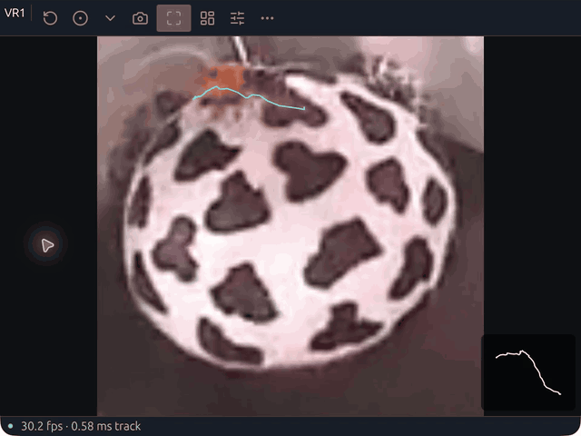
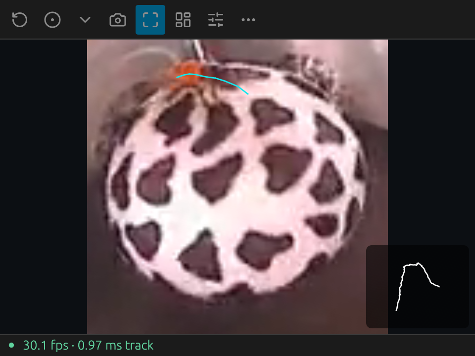
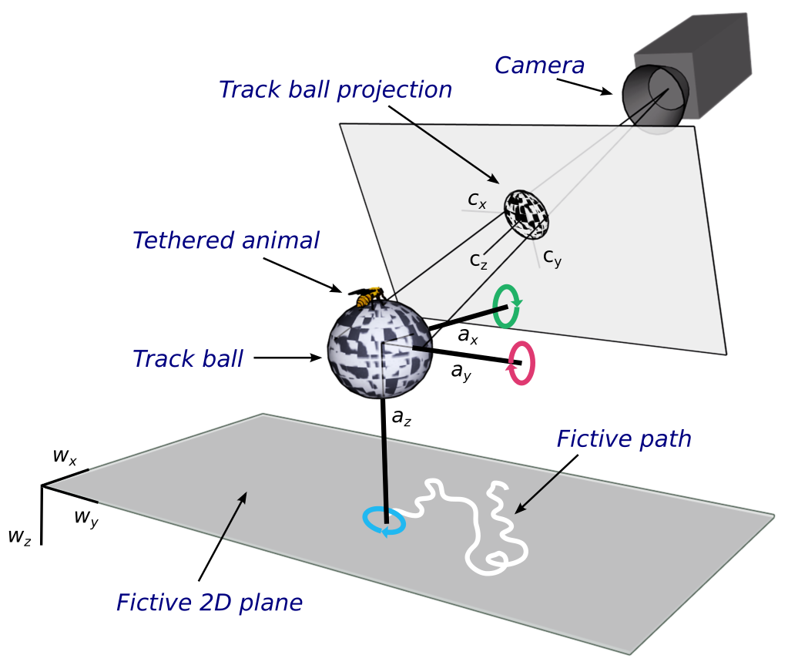

# HejjéTrac

**Native tracking for spherical treadmills.**

**HejjéTrac** (`hejjetrac`) is a modern Rust reworking of [FicTrac](https://github.com/rjdmoore/fictrac), with a compact desktop app, guided calibration and independent sessions for several rigs. Track a patterned ball, inspect its motion and record the data from the same window.

**[Download now](https://pvnkmrksk.github.io/hejjetrak/?download=1)** · [User manual](https://pvnkmrksk.github.io/hejjetrak/manual/) · [Website](https://pvnkmrksk.github.io/hejjetrak/) · [GitHub](https://github.com/pvnkmrksk/hejjetrak)



*The native app processing the supplied FicTrac sample. [Watch the video](docs/images/tracking-demo.mp4).*

Created by **[Pavan Kumar Kaushik](https://github.com/pvnkmrksk)**. The name combines **ಹೆಜ್ಜೆ** (*hejjé*, roughly **HEY-jay**), Kannada for a footstep, footprint or path, with **Trac**, following FicTrac’s spelling: **HEY-jay-track**. [Word origin](https://alar.ink/dictionary/kannada/english/%E0%B2%B9%E0%B3%86%E0%B2%9C%E0%B3%8D%E0%B2%9C%E0%B3%86).

## Open and start

Download the package for your computer, extract it and open **HejjéTrac**. The app tries the first available camera and falls back to the bundled sample when a camera cannot open or deliver frames. Your own camera needs its own [calibration](https://pvnkmrksk.github.io/hejjetrak/manual/calibration.html).

| Platform | First launch |
|---|---|
| macOS · Apple Silicon or Intel | Open `hejjetrac.app`. If blocked as an unidentified developer, attempt to open it, then use **System Settings → Privacy & Security → Open Anyway**. [Apple's instructions](https://support.apple.com/en-us/102445). |
| Windows · x64 | Extract the ZIP and open `hejjetrac.exe`. If SmartScreen offers it, use **More info → Run anyway** for the downloaded release. [Windows details](https://pvnkmrksk.github.io/hejjetrak/manual/install.html#windows). |
| Linux · x86_64 | Install the Debian/Ubuntu `.deb`, or extract the portable archive and launch `hejjetrac`. Current binaries require **glibc 2.39+**. [Distribution requirements](https://pvnkmrksk.github.io/hejjetrak/manual/install.html#linux). |

Current downloads are ad hoc signed on Mac and unsigned on Windows. Use the project's release files; managed computers may require administrator approval for a first-launch exception. [Installation and permissions](https://pvnkmrksk.github.io/hejjetrak/manual/install.html) covers the exact prompts. No Rust installation or compiler is needed. Older releases use `hejjetrak` filenames; existing commands remain available as aliases.

## Built for the experiment

- **A focused tracking window.** Ball preview, path, delivered FPS and tracking time stay visible. Settings open in a separate inspector.
- **Guided calibration.** The ball outline fits live from three rim marks. Redraw exclusions and lab axes in turn, with a precision magnifier, right-click correction and the original FicTrac coordinate conventions.
- **Independent rigs.** Each window has its own source, calibration, recording and outputs. Tile up to sixteen windows.
- **Complete recording.** Save data, source video and diagnostic video. Every take retains all-frame numeric data, quality decisions and its configuration.
- **Live output.** Use UDP, serial or localhost ZeroMQ for downstream experiments. The CLI, JSONL and MCP interfaces call the same numerical engine as the desktop.
- **A Rust application.** Native windows and camera APIs, Rust video codecs and a shared engine. No OpenCV, FFmpeg executable, Python runtime or webview is required.



[First session](https://pvnkmrksk.github.io/hejjetrak/manual/quick-start.html) · [Hardware and lighting](https://pvnkmrksk.github.io/hejjetrak/manual/hardware.html) · [Calibration](https://pvnkmrksk.github.io/hejjetrak/manual/calibration.html)

## Companion experiments and analysis

[MATREX VR](https://github.com/pvnkmrksk/matrexVR) supplies configurable Unity visual environments for animal experiments, with a [complete manual](https://pvnkmrksk.github.io/matrexVR/manual/) covering rigs, display mapping, tracking units, recording and replay. Match its exact release/source input contract to HejjéTrac's native FT output or the appropriate adapter; native FT decoding and modern transport updates are current-source additions after MATREX VR 0.3, not a change to that archived binary. [Connection guide](https://pvnkmrksk.github.io/matrexVR/manual/input-contracts.html).

[Daari Deepa](https://github.com/pvnkmrksk/trajectory-dashboard) provides browser-based trajectory analysis. [Rekkefly](https://github.com/pvnkmrksk/rekkefly) is the companion flight/wing tracker. These are separate tools with their own releases and output contracts.

## Coordinates and configuration

The manual retains FicTrac’s original [coordinate guide](book/src/upstream-coordinates.md), [complete parameter table](book/src/upstream-parameters.md), [hardware and algorithm notes](book/src/upstream-setup.md) and [25-column data reference](book/src/upstream-data.md), with their source and license. [Current configuration](book/src/configuration.md) and [output semantics](docs/output.md) describe the Rust application’s additions.



*Original FicTrac illustration by R. J. D. Moore and contributors, CC BY-NC-SA 3.0. [Source and unchanged image](docs/images/upstream/README.md).*

## Several rigs, one launch

The desktop accepts a grid directly:

```sh
hejjetrac --windows 4 --grid 2x2
hejjetrac --windows 16 --grid 4x4
hejjetrac --config VR1.txt --window-size 480x360
```

Keep a saved config for each physical rig, with distinct output ports. Bundled `VR1.txt`–`VR4.txt` are examples from the original setup; review camera IDs and calibration before collecting data. Actual camera capacity depends on capture bandwidth, recording and your computer. [Multi-rig setup](https://pvnkmrksk.github.io/hejjetrak/manual/rigs.html).

For recorded video:

```sh
hejjetrac-cli track --config examples/benchmark/config.txt --input examples/sample.mp4 --output runs/benchmark
```

The companion CLI is in the extracted folder; on macOS it is inside `hejjetrac.app/Contents/MacOS`. [CLI reference](https://pvnkmrksk.github.io/hejjetrak/manual/cli.html) · [Agent control](docs/agent-control.md).

## Tracking and validation

HejjéTrac preserves FicTrac's legacy config text and data conventions, and checks the full supplied video against the supplied FicTrac output. Known-motion synthetic sequences cover rotation accuracy. The Rust optimizer and recovery policy differ from upstream; [compatibility](docs/parity.md), [validation](docs/validation.md) and [output semantics](docs/output.md) document those details and platform coverage. Rejected frames remain in the all-frame data; motion during a missing interval is left unmeasured.

Native release CI runs on Windows, Linux, Apple Silicon and Intel Mac. Camera and GUI hardware checks are documented per platform. [Tracking performance](docs/tracking-performance.md) and [resource use](docs/resources.md) contain the fixture, hardware and timing boundaries for the published benchmarks.

## Build and contribute

Install [Rust](https://rustup.rs/) 1.95 or later, then:

```sh
cargo run --release --locked
cargo fmt --all -- --check
cargo clippy --workspace --all-targets --locked -- -D warnings
cargo test --workspace --locked
```

Cargo retains the compatibility names `fictrac` and `fictrac-desktop`. The workspace separates `fictrac-core`, I/O, native capture, shared control, CLI and desktop; the engine has no UI, filesystem, network or codec dependencies. [Architecture](docs/architecture.md) · [Contributor guide](AGENTS.md) · [Build instructions](https://pvnkmrksk.github.io/hejjetrak/manual/development.html).

## Citation and license

If you use HejjéTrac in research, cite the version you used and the original FicTrac method:

> Pavan Kumar Kaushik. *HejjéTrac: native spherical-motion tracking.* [Software repository](https://github.com/pvnkmrksk/hejjetrak).
>
> R. J. D. Moore et al. (2014). *FicTrac: a visual method for tracking spherical motion and generating fictive animal paths.* Journal of Neuroscience Methods 225, 106–119. [doi:10.1016/j.jneumeth.2014.01.010](https://doi.org/10.1016/j.jneumeth.2014.01.010).

[CITATION.cff](CITATION.cff) supplies machine-readable citation metadata. [Archiving instructions](https://pvnkmrksk.github.io/hejjetrak/manual/citing.html) describe connecting a release to Zenodo.

FicTrac was developed by R. J. D. Moore, Saul Thurrowgood and collaborators. This project preserves its **CC BY-NC-SA 3.0** license and openly credits its algorithms, examples, illustrations and documentation. [Attribution](ATTRIBUTION.md) · [License](LICENSE) · [Dependency notices](THIRD_PARTY.md).
