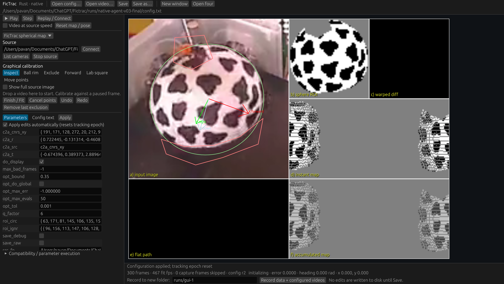

# hejjetrak

A native Rust rebuild of FicTrac with a native desktop GUI and a headless CLI. The tracker, H.264 decoder, calibration tools and GUI are Rust. Camera capture uses operating-system APIs; there is no OpenCV, NLopt, FFmpeg executable, webview, Python runtime or model download in application execution. No administrator privileges are needed.

The GUI shows the traditional input / thresholded sphere / warped difference / instant map / path / accumulated map layout. Open a video or camera, draw the ball rim and exclusion polygons, set the forward direction or calibrate from a square, and edit the original FicTrac configuration alongside its raw text. The file representation preserves unknown parameters, comments and formatting. Undo/redo works across graphical, field and text edits.

The recorded-video system now includes global relocalisation, sphere templates, bad-frame recovery, native serial/UDP output, raw/debug recording, a complete headless command frontend, JSONL agent control and a local MCP server. Agents can also control the actual native GUI through `--control-stdio`. Both use the same tracking, calibration and codec implementations. See [agent control](docs/agent-control.md).

**Compatibility boundary:** this is not a claim of bit-identical or unrestricted parity. Rust BOBYQA/global multistart differs from upstream NLopt. All five original recording codecs are implemented, including segmented OpenDML AVI. The supplied H.264 video workflow is regression-tested against the original output; the built-in Mac camera is now tested at 640×480 and nominal 30 fps, including raw/debug recording and reopening. See [the precise parity matrix](docs/parity.md) and [validation evidence](docs/validation.md).



Download platform archives from [Releases](https://github.com/pvnkmrksk/hejjetrak/releases). The first public version is v0.1.0; earlier local validation labels describe internal prototype iterations. Archives include the sample, configs, documentation and dependency license notices. macOS builds are ad hoc signed, not notarized; Windows builds are not Authenticode signed.

## Run the desktop

Install [Rust](https://rustup.rs/) 1.95 or later. Windows needs the standard Visual Studio linker/build tools. Linux needs the usual desktop development packages for Wayland/X11 and camera access. Cargo fetches dependencies on the first build; the resulting executable needs no Rust installation.

```sh
cargo run --release --locked
```

The included 384 × 288 sample opens automatically. Or select a configuration:

```sh
cargo run --release --locked -- --config examples/upstream-config.txt --windows 4
```

Use the built `target/release/fictrac-desktop` (`.exe` on Windows) directly after building. A local development macOS app, when created in this workspace, is `target/local/FicTrac.app`. It is locally ad hoc signed and tied to the current workspace's sample assets; packaging and distribution are a later step.

- **Open video** or drop a supported video onto a window to begin processing. **Cameras** lists devices; enter a numeric ID and connect. macOS requires Camera permission. A changed resolution needs its own calibration.
- **New window** selects the next existing BR/VR configuration or numbered config. Otherwise it copies the current config and increments only numeric camera IDs. Video paths stay video paths. **Open four** creates four independent native windows.
- **Ball rim**: click at least three rim points, then fit. **Exclude**: draw a polygon and finish with Enter. **Forward**: drag in the input panel. **Square**: select XY/YZ/XZ, then click top-left, top-right, bottom-right, bottom-left. Calibration tools pause the stream. **Move points** adjusts saved geometry.
- Parameters and **Raw config** share one document. Auto-apply waits briefly for editing; applying calibration starts a new tracking epoch. **Save** writes explicitly. External edits reload when the document is clean; a dirty conflict is shown and never silently overwritten.
- **Record** writes accepted-row `.dat`, full `all-frames.dat`, quality CSV and config for each epoch, plus actual raw/debug videos selected by `save_raw`, `save_debug` and `vid_codec`. Enabling video output also starts a new automatic recording directory. H.264 AVI is the original default; XVID AVI, MPEG-4 MP4, MJPEG/raw AVI and explicit `h264_mp4` are also available. H.264 recording uses High profile with independent frames to avoid costly inter-frame search; this trades compression for CPU throughput. Encoders finalize on stop/close; incomplete videos remain `.partial`.
- Shift+R resets pose/path while retaining source count and integrated displacement. Escape closes through the normal unsaved-change flow.

Input supports 8-bit H.264 and MPEG-4 Part 2 MP4/MOV/AVI, MJPEG/raw AVI and mono/420 Y4M. H.264 recording supports even dimensions using standard SPS cropping; other supported codecs can preserve odd dimensions. Native camera adapters use AVFoundation on macOS, Media Foundation on Windows and V4L2 on Linux. Live acquisition, recording and reopening are verified on the built-in FaceTime HD camera at 640×480. Physical sphere accuracy, iPhone/industrial cameras and native Windows/Linux execution remain unverified.

## CLI and the upstream benchmark

```sh
cargo build --workspace --release --locked
cargo run -p fictrac --release --locked -- track --config examples/benchmark/config.txt --input examples/sample.mp4 --output runs/benchmark
cargo run -p fictrac --release --locked -- compare --reference examples/benchmark/upstream.dat --candidate runs/benchmark/tracking.dat --report runs/benchmark/comparison.json
```

`compare` requires matching frame counts and aligned video timestamps, then checks rotation-component, path and wrapped-heading errors. Default limits are 0.020 rad/component, 0.075 sphere rad path RMSE and 0.025 rad heading RMSE. Failure returns a nonzero exit status. The reference is another implementation's output, not measured physical ground truth. The benchmark files are preserved as supplied under `examples/benchmark/`.

Run the same system through an AI agent or other machine client:

```sh
./target/release/fictrac schema
./target/release/fictrac agent < examples/agents/sample-session.jsonl
./target/release/fictrac mcp
./target/release/fictrac-desktop --control-stdio
```

The JSON Schema describes every action. Commands cover config/history, all graphical calibration equivalents, sources, stepping/running/reset, multiple sessions, templates, snapshots, recording, export and shutdown. MCP uses stdin/stdout and needs no model key or network server. The native GUI bridge marks queued work explicitly; poll status for completion. [Protocol and examples](docs/agent-control.md).

Other CLI operations:

```sh
cargo run -p fictrac --release --locked -- demo --output runs/demo --frames 120
cargo run -p fictrac --release --locked -- inspect examples/sample.mp4 --decode
cargo run -p fictrac --release --locked -- track --config examples/sample.json --output runs/sample
```

`demo` generates known-motion video and checks its recovered rotations. `inspect --preview first.pgm` saves decoded luma. `calibrate --help` describes headless rim fitting. CLI output directories must be new; completed runs contain `tracking.dat`, `quality.csv`, `summary.json` and `path.svg`. See [the output contract](docs/output.md) before interpreting error scores, timestamps or rejected frames. Legacy `.txt` defaults to map tracking; the alternative photometric estimator is selected with `rust_engine : pairwise`. JSON is a strict CLI format; the desktop edits legacy FicTrac text.

## Structure and checks

```text
fictrac-core       geometry, threshold/map and pairwise estimators, SO(3), path, debug views
fictrac-io         lossless legacy configs, JSON, Rust codecs, .dat, comparison, SVG
fictrac-camera     native OS capture, bounded latest-frame handoff
fictrac-control    shared deterministic commands, JSONL, MCP and recording orchestration
fictrac            headless CLI and known-motion demo
fictrac-desktop    native egui/wgpu windows, graphical calibration, workers, recording
```

```sh
cargo fmt --all -- --check
cargo clippy --workspace --all-targets --locked -- -D warnings
cargo test --workspace --locked
```

The engine has no UI, filesystem, network or codec dependencies. [Architecture](docs/architecture.md) explains the boundaries, informed by PhotoCraft's engine-first approach. CI is configured for native macOS/Windows/Linux builds; release results are recorded separately after execution. [Validation](docs/validation.md) distinguishes local results, cross-compilation and unverified hardware.

## Attribution

FicTrac was developed by R. J. D. Moore and collaborators. Research users should cite [Moore et al. (2014)](https://doi.org/10.1016/j.jneumeth.2014.01.010). This rebuild preserves upstream's **CC BY-NC-SA 3.0** terms. See [ATTRIBUTION.md](ATTRIBUTION.md), [LICENSE](LICENSE) and [THIRD_PARTY.md](THIRD_PARTY.md).
