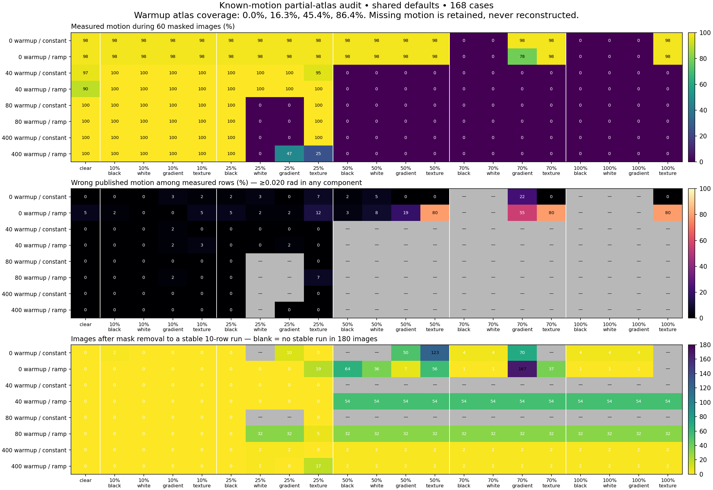

# Partial atlases, masking and shared defaults — 2026-10-27

**Historical default assessment before the new supplied takes.** The
[current high-speed take validation](take-validation.md) adds conditional
previous-image refinement and a null-match guard above the base history ceiling,
and repeats this masking audit. The results below remain bound to their original
source/binary hashes; they are not silently reassigned to the newer build.

This follows the [initial raw-video tuning experiment](raw-video-validation.md)
on fetched main `6c0bea6`. The supplied video and existing VR1–VR4 rig files remain
unchanged. Application and numerical code remain Rust; development plotting and
comparison scripts are not runtime dependencies.

The ready-to-run [original-video 47° calibration](../examples/raw47/supplied-video.txt) now omits every
numerical tracking override. Shared defaults retain quality 6, a 0.35-radian
per-axis window, threshold ratio/window 1.25/0.25 and adaptive error floor 10000.
The default optimizer budget increases from 50 to 100. Explicit saved values,
including the original rigs' 50 evaluations, remain respected.

The default behavioral changes are:

- Clean initialization needs mixed black/white support across at least half the
  active ROI, using a cross neighborhood of radius `max(ROI width / 8, 1)`.
  Supported images teach marking interiors normally. Lower-support accepted
  views require local support for each new cell.
- When continuous motion changes appearance, an independent, spatially checked
  previous-accepted-image comparison may support acceptance above the adaptive
  score limit, within the existing 18000 ceiling and explicit `opt_max_err` cap.
  Texture, motion, sample-support and consecutive-history checks remain active.
- Four-image acceleration confirmation permits first-hit teaching of supported
  new surface during probation; already learned cells remain protected.
  Ordinary recovery retains its complete teaching deferral.

[Recovery policy](recovery.md) specifies every bound. Full persistent-map MSE
remains reported, rejected frames cannot teach, and recovery never reconstructs
relative motion across a missing interval. Calibration of FOV/rim/exclusions/axes
is still required; these defaults do not infer optical calibration.

## Known-motion experiment

The Rust renderer uses a fixed 180×90 equal-area binary material texture and
calibrated rays for a 160×160 image. Rotation is prescribed in 3D; masks overwrite
source pixels before ordinary thresholding/fitting. Coverage is the requested
fraction of usable visible-ball pixels, selected contiguously by image x, rather
than the fraction of a square bounding box. No optimizer result supplies truth.

The 168-case matrix crosses:

- Zero, 40 stationary, 80 turning or 400 turning warmup images. Actual initial
  committed atlas coverage is recorded per case; none is assumed complete.
- Constant 0.012 rad/image motion or a ramp from 0.012 to 0.065 rad/image.
- Clear controls and 10%, 25%, 50%, 70%, 100% source coverage by black, white,
  gradient or fixed unrelated textured panels.

Each case has 60 masked images and 180 clear images continuing into new views.
Another 48 cases return to the pre-mask known pose when the panel disappears;
the abrupt return is included in the quaternion oracle, not silently excluded.
Another 24 use a moving black panel or gradually growing unrelated texture,
with 25%/70% target coverage and the three nonzero warmups. Thus there are
**240 known-motion synthetic cases**. Forty/80-image warmups specifically test
protection and recovery before most of the atlas is learned; 400 images test
broader coverage, not the 1024-teaching-hit mature-cell boundary.

The audit retains every prescribed increment, output increment, status and MSE.
A diagnostic wrong row has at least one component error ≥0.020 rad. This is a
per-row diagnostic, not a replacement for the existing **0.008 rad/component
synthetic RMS regression gate**. Accepted-only RMS accompanies measured-row
counts and is null when there are no measurements. The bound aggregate also
retains all-decision RMS against truth, including zero missing-data placeholders.
Rejected or relocalized zero deltas never count as measured motion.

Stable recovery is the first of ten consecutive measured clear rows below that
per-row diagnostic error. Missing stable recovery after 180 clear images is
reported explicitly. Known material sign disagreement in the atlas is a
threshold/projection diagnostic, not a calibrated probability of contamination;
clear controls themselves have nonzero disagreement. Exact atlas equality on
rejection and throughout severe-mask probation is checked separately.

## Results

Initial atlas coverage is **0%, 16.3%, 45.4% and 86.4%**. No rejected
frame changes its committed atlas in any final synthetic case.

| Known-motion audit | Cases | Masked measured / scheduled | Wrong published masked rows | Clear measured / scheduled | Wrong published clear rows | No stable clear recovery within 180 images |
|---|---:|---:|---:|---:|---:|---:|
| Full coverage/panel/acceleration matrix | 168 | 4608 / 10080 | 241 | 22692 / 30240 | 171 | 32 |
| Return to a previously known view | 48 | 940 / 2880 | 5 | 8046 / 8640 | 3 | 0 |
| Moving/growing panels | 24 | 681 / 1440 | 3 | 3147 / 4320 | 14 | 5 |

All **48 known-view return cases** obtain a stable ten-row clear run within
32 images. Every case's measured clear component RMS is below the unchanged
0.008 rad gate; the worst is 0.006286 rad. All 24 severe 70% known-view mask cases
publish no masked motion and leave their atlases byte-identical through masking.
The dedicated early-atlas CI regression covers eight of those severe cases,
requires stable recovery within 20 images and retains the same RMS gate.

The matched 64-case 25%/70% subset provides controls against the original
quality-6/50-evaluation policy and against raising its error floor alone:

| Policy | Masked measured / 3840 | Wrong published masked rows | Clear measured / 11520 | Wrong published clear rows | Cases without stable clear recovery |
|---|---:|---:|---:|---:|---:|
| Original policy, floor 10000 | 1703 | 165 | 7887 | 65 | 16 |
| Original policy, floor 18000 | 2587 | 244 | 10504 | 398 | 1 |
| Final shared defaults | 1636 | 110 | 8678 | 72 | 12 |

Wrong masked rows fall by one third with similar measurement availability;
clear availability improves, while the clear wrong-row count increases slightly.
Raising the floor alone measures more images but publishes substantially more
wrong motion. The final policy is not perfect occlusion detection. A narrower
seeding prototype reduced wrong masked rows further, but delayed clean startup
and broke full VR3 fast-motion gates. Widening that rule fixed startup but still
broke fast continuity; both were discarded. The final support-quorum rule retains
ordinary teaching of sufficiently supported ball markings.

The 32 full-matrix failures to resume a stable clear run and five moving/growing
failures are retained, not relabeled as correct zero motion. Before the atlas
contains the surface that reappears, a clear image can still lack an absolute
match. Returning to known texture succeeds in this fixture; continuing into an
unknown side is not guaranteed. Cold startup behind unrelated texture is still
ambiguous and can teach a wrong atlas. Of the full matrix's 241 wrong masked
rows, 231 occur in cold-start cases. Fully uniform black/white masked startup
waits for visible texture, but the support quorum cannot recognize every
textured impostor. These are measured limits of the default policy.



## Real-image panel controls

A separate pure Rust video audit decodes all 300 images of `examples/sample.mp4`
once. Its original optical calibration/exclusions are retained; numerical
tracking fields are omitted so it uses current defaults. The mask-free and
masked trackers receive identical 10 ms clocks and ping-pong source images,
without a last-to-first discontinuity. Warmups of 10/40/120 images, target
coverage of 10/25/50/70%, and all six panel types produce **72 cases**. Each has
60 masked and 180 clear images, with all numeric/quality rows retained.
The unmasked replay is a control, not physical ground truth. Counts of differences
≥0.020 rad/component are disagreements with that control, not proven physical
errors. Its instability under panels remains a material limitation.

Across 4320 masked input rows, 2686 publish motion and 978 of those differ
from their unmasked control by at least 0.020 rad in a component. Across 12960
clear suffix rows, 10634 publish motion; nine cases publish no clear suffix
motion within 180 images. The worst accepted clear component RMS disagreement
is 0.050638 rad. No rejected frame changes the atlas. These controls expose
substantial ambiguity under partial masking, even though the normal unmasked
sample passes its reference gates. They do not establish physical accuracy of
either the masked or control estimates, and are not counted as 72 passing
accuracy regressions.

## Supplied video and native replay

The original video SHA-256 remains
`217c3f1d27cd5d050566d30921e177c5fee921e3b2fa8bddcf9ec825b15f7cc3`:
3565 images, 640×480, 100 FPS. VFOV is the user-supplied 47°, the fitted ball
rim is retained, and lab axes remain explicitly unverified.

The calibration-only final replay retains all 3565 numeric/quality rows:
**3552 tracked, ten unaccepted, two relocalized and one initializing**. Each
unaccepted run is five images (1339–1343 and 2994–2998, zero-based source IDs).
Including the zero-delta relocalizations at 1344 and 2999 leaves two 60 ms
unmeasured intervals, totaling 120 ms. Main with the same fitted rim had 2202
unaccepted images; no trajectory is filled across the remaining gaps.

| Same-numerical-config original FicTrac comparison | Final defaults |
|---|---:|
| All-decision rotation component RMS disagreement, rad | 0.005836 / 0.004236 / 0.008116 |
| Measured angular-speed correlation | 0.978632 |
| Complete path-point RMS disagreement, sphere rad | 0.378505 |
| Endpoint disagreement, sphere rad | 0.348557 |
| Wrapped heading RMS disagreement, rad | 0.051673 |

The earlier zero-rejection prototype had 1.631773 sphere-radian path RMS
against the same baseline and failed existing VR3 continuity/rolling gates.
It is not the final version. The historical individually tuned quality-12
profile had better raw-video agreement than these defaults, but quality 12 was
not adopted as a default because a fast known-motion fixture regressed.

The final native desktop processes all 3565 images with every one of its 25
numeric columns byte-identical to the final CLI and matching shared quality
fields. Normal and diagnostic actual X11 window pixels were inspected; the rim,
ROI, maps, path and controls render correctly. Numeric completion is clean,
wire/media outputs are disabled, the canonical config hash is unchanged, and
only the test-owned window is closed. This is native Linux execution, not a
cross-platform runtime claim.

The installed C++ FicTrac runs from a private copied config because it rewrites
that file. The baseline explicitly matches quality 6, 100 evaluations, 0.35 bound,
0.001 tolerance and 1.25/0.25 thresholds. Every source-frame ID is joined exactly,
with no fitted lag, scale or axis transformation. Original timestamp anomalies
remain listed; derivative comparisons use the shared 10 ms video clock.
Neither implementation is ground truth. Greater availability cannot establish
physical accuracy or erase accumulated trajectory disagreement.

## Regression checks and reproduction

On native Ubuntu 22.04.5 x86-64, Rust 1.99.1 / LLVM 23.1.1, the final source
passes `cargo fmt --all -- --check`, locked all-target workspace Clippy with
`-D warnings`, and **299 locked workspace tests**, with zero failed/ignored.
No existing synthetic, decoder, sample or VR3 tolerance/reference constant changes.
The release workspace binaries and all development examples build successfully.
The eight severe partial-atlas regression cases preserve their existing
0.008 rad/component accuracy gate; actual default sharp and exposure-blurred
fast-motion cases pass the same gate.

Serial release validations on the Intel Core i7-6700K (8 logical CPUs) include:

| Fixture | Images | Accuracy / decisions | Wall boundary |
|---|---:|---|---|
| Known-motion release demo | 120 | Component RMS 0.00030405 rad, below its unchanged 0.003 gate | 0.745 s command wall; includes generation, pure Rust decode, tracking and output |
| Original calibrated sample | 300 | Zero rejections; path RMS 0.04480675 sphere rad; heading RMS 0.01318481 rad; components 0.008761 / 0.008292 / 0.014211 rad | 1.830 s track command wall; includes decode, tracking and output |
| VR3 plus fresh post-hand suffix control | 5157 full-video images, plus suffix | All 4678 pre-hand and all 410 fast images tracked; every unchanged rolling/reference/recovery gate passes | 46.530 s benchmark command wall; includes both replays, suffix construction, metadata and comparison |

VR3 pre-hand component RMS remains 0.006677 / 0.006547 / 0.009413 rad and
complete path RMS remains 2.485641 sphere rad; increment gates do not imply
long-sequence path identity. Release cases execute serially, while development
checks can load the machine; these elapsed times are scoped execution evidence,
not speedup or real-time-throughput claims. The 3565-image supplied replay takes
76.033 s command wall under validation load; its 100 FPS metadata does not
establish real-time execution.

```sh
cargo run --release --locked -p fictrac-io --example masking_audit -- runs/new-masks 10000 full
cargo run --release --locked -p fictrac-io --example masking_audit -- runs/new-returns 10000 return
cargo run --release --locked -p fictrac-io --example masking_audit -- runs/new-moving 10000 advanced
cargo run --release --locked -p fictrac-io --example video_masking_audit -- examples/sample.mp4 CALIBRATION_ONLY_CONFIG runs/new-real-masks
cargo run --release --locked -p fictrac -- track --config examples/raw47/config.txt --output runs/new-raw
```

Output directories must be new. For the real-image default audit, copy
`examples/benchmark/map-config.txt`, retaining its geometry/exclusions/axes and
removing `q_factor`, `opt_max_evals`, `opt_bound`, `opt_tol`, `opt_max_err`,
`rust_resilient`, `rust_resilient_error_floor`, `thr_ratio`, `thr_win_pc`.
Do not edit the original fixture or rig config. All audit cases run serially;
loaded exploratory wall times are not comparative throughput claims.

[Bound machine-readable evidence](benchmarks/masking-20261027.json) retains
per-case measured counts, errors, recovery latency, atlas diagnostics, all-row
file hashes, source/build/config/binary identities, original comparison,
commands, platform and validation logs. Private inputs and per-frame outputs
stay in ignored local run directories. Nothing is uploaded or installed.
