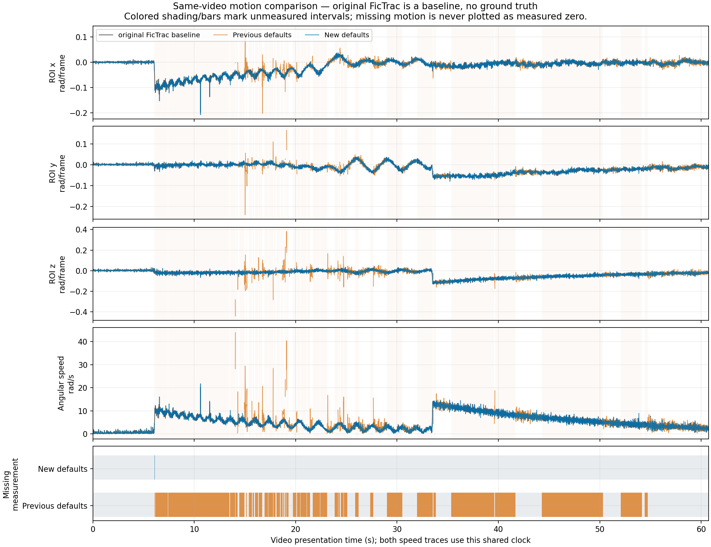

# Supplied takes: clear high-speed tracking at 17° and 47°

This focused follow-up uses the user's two 2026-10-27 takes. It reproduces the
47° failure with the exact saved geometry and shared numerical defaults, then
compares the corrected Rust engine with original FicTrac. Inputs and original
rig/config files are read-only. The installed application is not replaced.
Private movies remain outside the repository; no video or source images are
uploaded or distributed here.

## Live 47° follow-up, 2026-10-28

The new live fast capture contains all 4579 MJPEG images at 640×480, with a
median FicTrac rotation magnitude of about 0.235 rad/image after calibration.
The saved three-point rim was slightly too large. An independent edge fit to
the mean of the first 120 source images supplies 52 distributed rim points;
the shared Rust rim solver retains 47° and changes angular radius from
0.3168377818 to 0.3083935001 rad (−2.665%). Centre changes only slightly. This
is a source-geometry correction, not a threshold fit to reference trajectories.
The original three-point config is preserved with the recording.

With the refit and the preceding engine, all 4578 relative increments in the
complete fast replay are tracked. Same-config original FicTrac remains stable;
component RMS differences are 0.00699/0.00787/0.01240 rad, and every rolling
100-image component comparison remains below the unchanged 0.020 rad gate
(worst 0.01791). The original geometry produces a large live failure; these
results do not imply immunity to inaccurate geometry.

A subsequent live numeric take also exposes capture intervals of 28–40 ms and
occasionally more than 100 ms, against roughly 10 ms normally. Its encoder
overloads after 78 images, so its complete 6673 numeric rows are not called a
complete video benchmark. Native delivered-frame counters cannot prove which
sensor images were lost. The complete earlier fast movie provides the repeatable
timing regression instead: omit the last three source images of every 80-image
block, retain the original recorded capture timestamps, and process every
remaining image without omitting any resulting quality decision.

On the same calibrated movie and 57 explicitly extended image intervals, the
old predictor measures 2895/4407 possible increments. Time-aware prediction
with bounded smooth proposals measures **4407/4407**, with no rejections or
relocalizations. Comparison against original FicTrac composes its delta
quaternions across the deliberately omitted images; no scale, lag, coordinate
transform or candidate missing-motion reconstruction is fitted. Component RMS
is 0.00705/0.00791/0.01264 rad; every 100-processed-interval component comparison
passes 0.020 rad (worst 0.01777). The unmodified complete movie remains
4578/4578 measured, with its ordinary rotation output unchanged to the writer's
12-decimal precision. Neither reference is physical ground truth.

The new known-motion capture-gap regression fails at the first four-interval
jump with the preceding predictor. It now tracks every image, including three-
and four-interval jumps and their following frames; gap-only component RMS is
0.00217/0.00301/0.00785 rad under the unchanged 0.008 rad synthetic limit. A
separate test ensures an ambiguous long-interval turn neither teaches the atlas
nor publishes/integrates invented relative motion. Normal clock jitter retains
the ordinary predictor. Numerical thresholds, q_factor and search width remain
unchanged. See [prediction and proposal details](architecture.md) and
[error/quality semantics](output.md).

The final native build is then tested live for 30.13 seconds with the saved
47° refit and source 0 (the first connected Arducam). All **3053/3053 recorded
frames are tracked**, with zero rejections/recovery rows at 100.925 delivered
frames/s. Every measured increment exceeds 0.08 rad; the maximum is 0.34253 rad.
The largest processed capture interval is 12.037 ms, so the controlled omission
fixture, rather than this final live run, establishes the longer-interval path.
This final run records numeric/quality evidence only; no simultaneous video
encoding throughput claim is made. All 3053 recorded wire messages match the
original Python republisher byte for byte, and the remote receiver reconnects
and acknowledges the new publisher. The native diagnostic pixels are visually
inspected, and the window remains live. Formatting, strict locked all-target
Clippy, all 303 workspace tests and the release demo/sample checks pass.
[Machine-readable inputs, hashes, boundaries and results](benchmarks/live47-20261028.json).

## Inputs and configuration check

| Take | Saved FOV | Numeric rows | Available video | Scope |
|---|---:|---:|---:|---|
| VR2, `take-1793133880524532382` | 17° | 7205 | 64 images, H.264 AVI prefix | Encoder stopped on queue overload; missing 7141 images cannot be benchmarked |
| VR1, `take-1793134575426458881` | 47° | 6075 | All 6075 images, raw BGR24 OpenDML AVI, 640×480 | Complete replay, including clear fast motion and brief hand contact |

The VR1 source is 5,600,933,620 bytes. Nine selected RGB images at source IDs
0/600/609/614/619/1062/3400/4660/6074 match independent decoding byte for byte,
including the region past the 4 GiB boundary. Both replays process exactly the
6075 source IDs in order. The saved rim follows the visible ball; no rim, FOV,
exclusion or axis correction is used to obtain the improved result. FOV remains
the user-supplied value, rather than an independently measured lens intrinsic.
Lab axes remain the saved identity and are not physically verified.

The take configs omit tuning fields. Rust therefore uses quality 6, 100 primary
local evaluations, a 0.35-radian per-axis prediction window, tolerance 0.001,
threshold ratio/window 1.25/0.25 and base resilient error floor 10000. Original
FicTrac runs with these values expanded explicitly in its own copied config,
because its omission defaults differ and it rewrites that file. Display,
recording and wire outputs are disabled for numerical replay only. Neither
source calibration nor original data is changed.

The user subsequently repurposed `examples/raw47/config.txt` for the live VR1
camera. That config is preserved. The original supplied `raw.avi` calibration
is frozen separately as [supplied-video.txt](../examples/raw47/supplied-video.txt),
so its existing regression does not accidentally use the newer camera rim.

## What failed and what changed

The original live VR1 take contains 2742 tracked, 3215 unaccepted and 118
relocalized rows. Cold replay with the preceding Rust defaults also fails:
2647 tracked, 3368 unaccepted, 59 relocalized and one initializing row. The live
run had pre-existing atlas/history and native capture timing; it is not claimed
to be byte-identical to a cold file replay.

Original FicTrac's correctly aligned replay reaches binary-map error about
22980 during fast motion. A fixed 18000 ceiling can therefore reject an
informative moving image. More importantly, the persistent atlas objective can
be biased by changed appearance while the immediately previous image still
provides a strong motion reference. After four-image acceleration confirmation,
demanding another three tracked images before using that reference creates a
second bootstrap failure during the very blur that prompted recovery.

The final engine changes are:

- On an uncertain fit or motion-history outlier, refine against the previous
  accepted binary image. Seed from the better temporal match of the predictor
  and primary candidate, retain the original per-axis prediction bounds, and
  select refinement only with spatial verification and at least 10% temporal
  MSE improvement. Recompute the reported score against the complete persistent
  atlas. Healthy primary fitting retains its original objective.
- Above the base 18000 MSE ceiling, require the existing strict temporal check,
  at least 32 persistent known sites, at least half the persistent ROI supported,
  and persistent MSE at most 85% of the independent-marginals null score
  `E[I²] - 2 E[I] E[M] + E[M²]`. This tests whether the persistent map still
  contains information about the image. An explicit `opt_max_err` always wins.
- Reuse the three visible increments already verified by strong four-image
  acceleration confirmation during its existing probation. Existing cells
  remain protected, only supported new cells can initialize, and rejection
  immediately revokes this bootstrap permission.

Each optimizer is capped by `opt_max_evals`; fallback adds at most five complete
comparison scores and two evidence passes. This is bounded extra computation,
not an unchanged total per-frame evaluation count. The previous-image reference
is invalidated on rejection, reset or map import. No hidden interval is bridged.
[Recovery](recovery.md) and [output](output.md) specify all remaining guards.

Controls retained locally include raising the error floor alone (no improvement),
legacy permissive policy (bad motion despite no rejections), source-area
averaging, median-based thresholding, and an appearance-only relaxation. The
smoothing variants did not solve the problem or preserve the existing VR3 gates
and are not kept. The final source does not alter the threshold preprocessing,
image-error units, calibration or decoder to obtain this result.

## Complete and clear-speed results

| Complete 47° file | Measured relative rows | Unaccepted rows | Zero-delta recoveries |
|---|---:|---:|---:|
| Preceding defaults | 2647 | 3368 | 59 |
| Final defaults, same saved calibration | **6070** | **3** | **1** |

Both also have one initializing image. Source images 609–611 are unaccepted;
612 relocalizes with zero relative motion. The 40 ms interval is unmeasured,
not reconstructed. It occurs within the first hand-contact event.

Across every source image, including all missing-data decisions, component RMS
disagreement with original FicTrac is **0.005985 / 0.005428 / 0.010436 rad**.
Complete raw path RMS disagreement is **0.427142 sphere rad**, endpoint
**0.484922 sphere rad**, and wrapped heading RMS **0.049830 rad**. Preceding
Rust path RMS was 13.052391 sphere rad. Measured angular-speed correlation is
0.968516. No lag, scale, axis transformation or trajectory fit is selected to
improve agreement. Original FicTrac has no independent quality flag and is a
baseline, not physical ground truth.

Speed bands use reference increments: ordinary below 0.04 rad/image, fast
0.04–0.08, very fast at least 0.08. They are per-image comparisons, not an
FPS-independent physical speed claim. The source video declares 100 FPS, while
native timestamps retain approximately 8/12 ms cadence and occasional longer
intervals; the AVI clock does not reproduce capture jitter.

Without excluding anything, **3447/3451 fast images are measured** (99.884%).
The first 500-image fast section measures 496 images; all 1100 images in the
second fast section are measured. The worst unexcluded rolling 100-image
component RMS is **0.020179 / 0.009175 / 0.015780 rad**. Its first component is
above the unchanged 0.020 gate, around the four unmeasured hand-contact rows;
this result is retained explicitly.

The input-only hand-presence annotation finds intervals **[545,625)** and
**[3298,3369)**: at least 100 pixels above grayscale 60 in source rows 0–109,
outside the fitted ball silhouette. These intervals were checked on linear
source images, do not use tracker output, and are SHA-bound to this video in
[the fixture manifest](../examples/benchmark/takes-20261027.json). They cover
hand approach/contact/withdrawal conservatively; they are not a general
occlusion detector. The user explicitly exempts occlusion failures.

Outside those intervals, **all 3413 fast images are tracked**. Component RMS is
**0.006314 / 0.005896 / 0.011224 rad**. Every clear rolling 100-image window passes
0.020, with maxima **0.012154 / 0.008988 / 0.015557 rad**. Complete numeric/quality
files still retain every excluded image. The benchmark emits both excluded and
unexcluded metrics; no threshold or reference constant is weakened.



## Native and existing regression checks

The actual VR1 V4L2 feed negotiates 640×480 at nominal 100 FPS without exposure
or gain edits. A short native take contains **1038 tracked numeric rows and
1038 encoded MJPEG images**, with clean completion, no queue overload and no
rejected rows. Native capture timestamps give **100.914 delivered frames/s**.
Observed increments include 57 frames above 0.04 rad/image, with maximum
0.058767 rad/image. Recorded-source aligned comparison of the native increments with original
FicTrac gives component RMS 0.005389 / 0.004858 / 0.010459 rad. Magnitude
correlation is only 0.546 in this narrower-speed run; the stored MJPEG also adds
a lossy generation. Precise live velocity agreement is therefore not established.
This is an observed-feed continuity/timing check, not a controlled maximum-speed
experiment or physical ground truth. Delivered/encoded counts do not
establish sensor-level completeness. The original combined test's subsequent
file-switch wait assumed a paused source and timed out; its successful live
subcheck is reported separately from that harness failure.

A fresh native file session processes all 6075 images and matches the final CLI
in **all 25 numerical columns byte for byte**, with matching shared quality
fields and clean recording/exit. Actual normal and diagnostic X11 pixels were
inspected. Only test-owned windows are closed, outputs remain off, and original
config hashes are unchanged.

Formatting, locked all-target strict Clippy and **300 workspace tests** pass,
with zero failed/ignored. Debug symbols were disabled for local check builds
after disposable compiler cache exhausted the initially low disk space; debug
assertions, overflow checks and numerical tolerances stay unchanged. Release
binaries/examples build with Rust 1.99.1 / LLVM 23.1.1 on native Ubuntu 22.04.5
x86-64, Intel Core i7-6700K (8 logical CPUs).

Serial release checks pass: the 120-image known-motion demo, original 300-image
sample, full 5157-image VR3 plus fresh suffix control, and original 3565-image
supplied video. VR3 retains every 4678 pre-hand and 410 fast-section measurement
and every unchanged rolling/recovery gate. The original supplied video now has
3555 measured rows, seven unaccepted rows and two zero-delta recoveries, retaining
all source rows and 90 ms of unmeasured motion. Command timing boundaries,
binaries, toolchain and platform are recorded in the bound evidence; timings
are scoped execution evidence, not a general throughput or speedup claim.

## Partial-view limits retained

All 240 known-motion masking cases and 72 real-image panel controls are repeated.
Rejected frames never change their atlases. All 48 known-view returns retain
clear component RMS below 0.008 rad. The broad continuation matrix still has
32 cases without a stable clear run; dense textured startup and wholly unseen
post-mask surface remain failure cases. The new policy measures more moving-mask
and real-panel rows but also publishes more wrong/disagreeing masked rows than
the previous default in some controls. It prioritizes the requested clear high-
speed continuity and is not perfect occlusion detection.

| Audit | Masked measured | Wrong/disagreeing masked rows | Clear measured | No stable/measured clear suffix |
|---|---:|---:|---:|---:|
| 168 known-motion continuation cases | 4616 | 268 | 22727 | 32 |
| 48 known-view returns | 943 | 11 | 8046 | 0 |
| 24 moving/growing panels | 793 | 12 | 3660 | 2 |
| 72 real-image panel controls | 2733 | 1002 | 10858 | 8 |

A wrong synthetic row has any component error at least 0.020 rad; accepted-only
RMS is accompanied by availability and is null when no rows are measured. Real-
image differences use the unoccluded replay as a control, not truth. These are
audit outcomes, not 312 passing accuracy tests. [Earlier matched controls](masking-validation.md)
and [bound current evidence](benchmarks/takes-20261027.json) preserve the tradeoff.

## Repeat the benchmark

```sh
python3 scripts/benchmark_takes.py \
  --take /home/pkaushi/Videos/hejjetrak/VR1/take-1793134575426458881 \
  --original-fictrac /home/pkaushi/src/fictrac/bin/fictrac \
  --annotations examples/benchmark/takes-20261027.json \
  --output runs/new-vr1-benchmark --require-pass
```

Run from the repository root; the default candidate is `target/release/fictrac`.
The output must be new. Repeat `--take` for additional takes. A prefix-only or
insufficient-fast-motion take produces unavailable gates and cannot pass
`--require-pass`; use it without that flag to inspect the available prefix.
The take runner uses original FicTrac only as an explicit development baseline;
the Rust application retains no subprocess/OpenCV/media dependency.

For another complete 17° source, choose a recording mode that can keep up with
capture. The supplied H.264 encoder sustained about 53 frames/s against 100 FPS
input and explicitly stopped after 64 frames; its complete numerical take is
preserved. The short live MJPEG take above completes, while the user's uncompressed
47° take also completes at a much larger file size. Neither is an unrestricted
long-duration recording guarantee.
