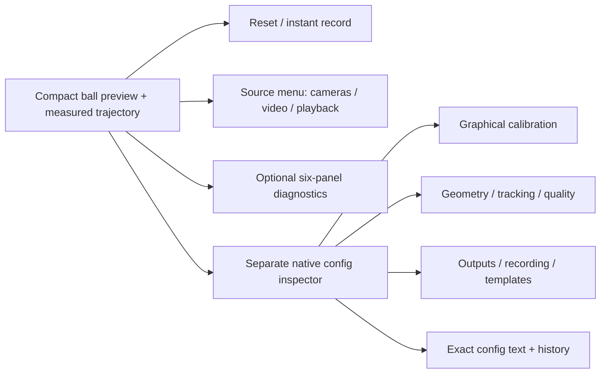

# Desktop design

The preview is a native OS window rendered by Rust egui/wgpu. The inspector is another native window; neither is a browser or webview. Widgets are Rust-drawn rather than AppKit/WinUI system widgets. Small previews progressively retain reset and recording, then reset alone; detail appears on request. The minimum preview is 96×96 logical pixels. Below 125 pixels of toolbar width only reset remains; 125–214 retains reset/record, 215+ exposes the compact full-image/settings controls, and wider layouts expose source/diagnostics.

The hierarchy follows [Apple toolbar guidance](https://developer.apple.com/design/human-interface-guidelines/toolbars) and [Microsoft command-bar guidance](https://learn.microsoft.com/en-ca/windows/apps/design/controls/command-bar): prioritize frequent commands, group related actions, move less frequent controls into secondary surfaces, and explain compact controls with tooltips. Icons are original native vector drawings; the application icon has an editable SVG source in assets/.

| Surface | Default | Equivalent command |
|---|---|---|
| Reset tracking | Toolbar | `reset` |
| Start/stop recording | Toolbar + mode chevron | `record_start` with optional `record_options`; `record_stop` |
| Camera/video selection | Source menu with cached device list | `source`, `camera_status`, `camera_format`, `camera_set` |
| Preview/diagnostics/guides | Preview first | Native `view` flags |
| Rim/exclusion/square | Inspector; source paused | `calibrate` kinds rim/exclude/square/square_cycle |
| Config fields/raw text | Inspector | `set`, `replace_config`, `config`, `undo`, `redo`, `save_config` |
| Instance/window placement | Overflow or startup args | `new_instance`; `--windows`, `--grid`, `--window-size`, `--window-position` |

Each camera format change starts a new tracking epoch and requires calibration appropriate to its geometry. Camera controls are enabled only when advertised by the native backend. A rejected frame is shown as Lost; its interval is unmeasured. The status tooltip separates delivered FPS, fit cost, complete worker processing, source budget and capture gaps. Running gaps exclude intentional pause/step boundaries; the full capture-gap counter remains inspectable.

The ball crop is projected with the selected camera model. Letterboxing fits the cropped pixel rectangle with one scale factor. Diagnostic source and map panels use the same rule; panel dimensions never distort pixel aspect. Calibration hit-testing maps back to source pixels, independent of crop and window size.

The native square editor keeps the legacy corner slots. Right-click can remove a corner, and the next click fills the missing slot without cycling the other corner labels. F changes the pose branch through the shared reflected-seed refit; it does not permute corners or silently choose a new coordinate convention.

## Guided calibration and precision aids

The inspector uses **View / 1 · Ball / 2 · Exclusions / 3 · Lab** steps, with **Place new points** and **Edit saved marks** modes. Only the active step's geometry is displayed/editable; the ordinary View step is for inspection. **Fit / apply**, **Clear draft**, **Next step →** and **Done / resume** keep a single task visible. Right-click removes the nearest active mark, including a particular saved square slot. A cursor-following **4× view magnifier** enlarges the current preview four times, accounting for crop/high-DPI scale, with an exact source-coordinate crosshair; it is available only during calibration. It does not alter tracking pixels. **Full image** is a display toggle independent of calibration and crop.

The graphical and headless shared operations can capture a resolution reference and adapt saved marks. `resolution_reference` records current or explicit dimensions, field of view/projection and normalized extension copies; `resolution_apply` regenerates legacy pixel fields for a same-aspect, same-configured-projection resize. Angular sphere and lab-pose values remain exactly as written. Imported legacy files are not silently normalized. Stale marks, aspect changes and configured projection/FOV changes reject atomically. A format switch can apply this only when opted-in reference metadata already exists; it cannot infer an undocumented sensor crop or optical change.

Window titles identify VR/session name, actual source identifier/path, available camera name, UDP/ZMQ ports and hejjetrak. Sources use canonical file paths or actual OS identifiers where available (AVFoundation UID, Media Foundation symbolic path, Linux backend-reported path). When a backend does not expose a reliable device node, the title reports its honest name/backend/index instead of inventing `/dev/videoN`.
