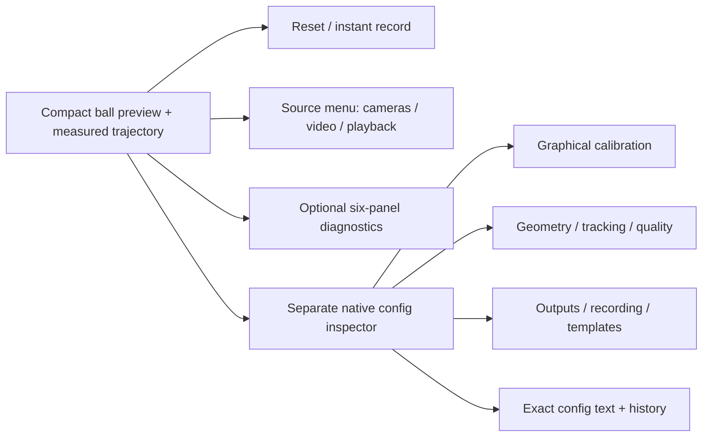

# Desktop design

The preview and inspector are native OS windows rendered by Rust egui/wgpu;
neither is a webview. Widgets are Rust-drawn, rather than AppKit/WinUI widgets.
The minimum preview remains 96×96 logical pixels. If the content is narrower than
160 pixels or shorter than 120, toolbar/status chrome disappears so the image
gets the available space; font sizes are not shrunk. The context menu retains
Reset, recording, Settings and Calibrate again. The status strip appears from
320×220; larger toolbars expose additional commands.

The hierarchy follows [Apple toolbar guidance](https://developer.apple.com/design/human-interface-guidelines/toolbars) and [Microsoft command-bar guidance](https://learn.microsoft.com/en-ca/windows/apps/design/controls/command-bar): prioritize frequent commands, group related actions, move less frequent controls into secondary surfaces, and explain compact controls with tooltips. Toolbar artwork is bundled from Lucide, with pinned source SVGs, embedded rendered assets and ISC/Feather MIT notices. No icon network request, custom icon font or render-tool runtime is required. See [third-party notices](https://github.com/pvnkmrksk/hejjetrak/blob/main/THIRD_PARTY.md). The application icon retains its editable SVG source.

| Surface | Default | Equivalent command |
|---|---|---|
| Reset tracking | Toolbar | `reset` |
| Start/stop recording | Toolbar + mode chevron | `record_start` with optional `record_options`; `record_stop` |
| Camera/video selection | Source menu with cached device list | `source`, `camera_status`, `camera_format`, `camera_set` |
| Preview/diagnostics/guides | Preview first | Native `view` flags |
| Rim/exclusion/square | Inspector; source paused | `calibrate` kinds rim/exclude/square/square_cycle |
| Config fields/raw text | Inspector | `set`, `replace_config`, `config`, `undo`, `redo`, `save_config` |
| Instance/window placement | Overflow or startup args | `new_instance`; `--windows`, `--grid`, `--window-size`, `--window-position` |

Each camera format change starts a new tracking epoch and requires calibration appropriate to its geometry. Camera controls are enabled only when advertised by the native backend. A rejected frame is shown as Lost; its interval is unmeasured. The status tooltip separates delivered FPS, fit cost, complete worker processing, source budget and capture gaps. Running gaps exclude intentional pause/step boundaries; the full capture-gap counter remains inspectable.

The ball crop is projected with the selected camera model. Letterboxing fits the cropped pixel rectangle with one scale factor. Diagnostic source and map panels use the same rule; panel dimensions never distort pixel aspect. Calibration hit-testing maps back to source pixels, independent of crop and window size.

The native square editor keeps the legacy corner slots. Right-click can remove a corner, and the next click fills the missing slot without cycling the other corner labels. F changes the pose branch through the shared reflected-seed refit; it does not permute corners or silently choose a new coordinate convention.

## Guided calibration and precision aids

**Calibrate again…** starts saved Ball review, then Exclusions, then Lab.
Review is read-only until **Edit saved marks** or **Redraw this step** is chosen.
**Keep & continue / Keep & finish** advances without rewriting fields. Edit
allows drag/delete only for active saved marks; redraw isolates a replacement
and leaves the previous config intact until a valid apply. Cancel discards only
uncommitted drafts. Exclusions can append a region or explicitly clear all masks.
The numerical replacements use shared calibration commands and one undoable
config transaction, rather than a second GUI-only geometry algorithm. A tiny
preview temporarily expands to 640×480 for calibration and restores its prior
size on completion; source pixels and numerical coordinates do not change.

The **Precision magnifier** is a 240-pixel nearest-pixel lens at four times the
current view scale, including crop/high-DPI scale. It shows fitted geometry,
numbered marks/TL/TR/BR/BL labels and source-coordinate crosshair. A mouse-
transparent native viewport sits outside the preview when space allows; an inset
away from the pointer is the fallback. It does not resize tracking input.
**Full image** independently controls source context and preserves aspect ratio.

The graphical and headless shared operations can capture a resolution reference and adapt saved marks. `resolution_reference` records current or explicit dimensions, field of view/projection and normalized extension copies; `resolution_apply` regenerates legacy pixel fields for a same-aspect, same-configured-projection resize. Angular sphere and lab-pose values remain exactly as written. Imported legacy files are not silently normalized. Stale marks, aspect changes and configured projection/FOV changes reject atomically. A format switch can apply this only when opted-in reference metadata already exists; it cannot infer an undocumented sensor crop or optical change.

Compact titles prioritize the applied instance label, ZMQ port and a short
source: `VR1 · ZMQ 9871 · Camera 0`, or the video basename. If the backend supplies
an actual `/dev/videoN` path, it can serve as the short camera label; no path is
invented from an enumeration ordinal. At 650+ logical pixels of outer window
width UDP/app identity is added; at 900+ the full actual source identifier/path
is also included. Applied source/output state wins over an invalid/unapplied
config draft. Full source and transport details remain in the inspector/status.

Closing one tracking window, including the first one opened, leaves other
sessions alive. Explicit application quit shuts them all down. Recording
finalization and unsaved-edit rules still apply per session.
